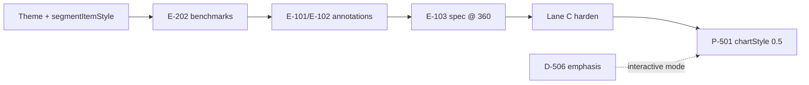

# AxiCharts engineering roadmap

Consolidated view of **what to build next** in this repository. Detailed audit matrices live in sibling docs — this file is the single entry point for contributors and release planning.

**Product direction** (competitive positioning, governance, cross-product RFCs) lives in [axiboard `docs/charts`](https://github.com/Axidify/axiboard/tree/main/docs/charts). **This file** tracks engineering backlog inside the axicharts repo.

**Last reviewed:** 2026-08-07

---

## How this doc relates to other trackers

| Doc | Scope | ID prefix |
|-----|--------|-----------|
| **[chart-design-audit.md](./chart-design-audit.md)** | Visual / UX parity vs Recharts, per chart type | **D-xxx** |
| **[chart-design-language.md](./chart-design-language.md)** | Prescriptive rules (themes, hover, typography) | — |
| **[render-audit.md](./render-audit.md)** | Layout / engine bugs (clipping, scale math) | **R-xxx** |
| **[RFC-005](./rfc/RFC-005-agent-chat-envelope-freeze.md)** | Agent-chat integration freeze (pre-0.5) | — |
| **[axiboard `docs/charts`](https://github.com/Axidify/axiboard/tree/main/docs/charts)** | Product RFCs, governance, competitive positioning | RFC-00x |

**Harnesses:** `pnpm storybook` · `pnpm render-sandbox` · `pnpm docs` → `/compare/design` · `pnpm test:visual`

When you ship work tracked here, update the relevant audit doc **and** this file's status column.

**GitHub issues** are for **bugs and regressions** — not roadmap items. Reference **D-xxx** / **E-xxx** / **P-xxx** IDs in PR descriptions instead.

---

## Current state (snapshot)

### Shipped and at Parity @ 360×280 (`cleanTheme`)

Cartesian lane A (Recharts wall): line, area, bar, horizontal bar, stacked bar, combo, scatter, cartesian blocks, sparkline.

Distribution lane A: pie, donut, histogram.

Matrix lane A: radar, heatmap.

Lane B (dashboard-adjacent): funnel, waterfall, calendar heatmap, stat, table.

Interaction uniformity **D-501–D-505**: hover tokens, ECharts `itemEmphasisOptions`, pie interactive dim, cartesian category band, plugin + Sankey alignment.

### Close — usable, internal consistency gaps remain

Lane C types are **N/A for Recharts** — goal is coherent compact tiles, not Recharts Parity.

| Area | IDs | Harness |
|------|-----|---------|
| Lane C niche @ 280×140 | **D-401–D-412** | `Audit/Niche industrial` |
| Studio editorial lane | **D-310** | `Audit/Studio` |
| Boxplot, violin, swarm, ridgeline, treemap, sunburst, candlestick | D-401–D-404, D-409–D-411 | catalog + Lane C wall |
| Industrial HMI @ 180×120 | D-405–D-408 | `Industrial/*` |

### In progress (uncommitted / landing)

| Item | Notes |
|------|-------|
| Theme token tightening | `cleanTheme` grid opacity, line stroke, bar radius — align with design-language spec |
| `segmentItemStyle()` | Treemap / sunburst / funnel gap separation on dashboard themes (`themeBridge.ts`) |

### Open / deferred (tracked)

| ID | Item | Detail in |
|----|------|-----------|
| **D-506** | uPlot mark emphasis (bar brighten, line dot on hover) | [design-audit § D-5xx](./chart-design-audit.md) — **interactive mode only**; static tiles intentionally have no hover |
| **D-507** | Waterfall value-bar emphasis on category hover | [design-audit § Interaction hover](./chart-design-audit.md) — transparent stack layer has placeholder `emphasis`; value series needs visible hover |
| **E-101** | Unify annotation surfaces (`marks[]` vs legacy `annotations` / `props`) | Multiple APIs coexist — see P0 below |
| Scatter sibling dim | Partial `emphasis` on multi-series scatter | [design-audit § Interaction hover](./chart-design-audit.md) |

---

## Prioritized backlog

### P0 — Ship in-flight polish + annotation unification

Highest leverage for dashboard tiles (static) and agent-generated panels.

| ID | Task | Status | Notes |
|----|------|--------|-------|
| — | Land theme token + `segmentItemStyle` changes | **In progress** | Affects every dashboard tile; re-run **E-202** after merge |
| **E-202** | Re-run `pnpm bench:all`; update `benchmarks/BENCHMARKS.md` | **Open** | Last published: 2026-07-17 |
| **E-101** | Unify annotation surfaces | **Shipped (spec)** | Cartesian `marks[]` is the single spec surface: `rule` (+ `x` / `id`), `band` (+ `id`), new `text` + `marker` overlay marks. Legacy `annotations` / `referenceLines` / `thresholdBands` normalize losslessly into marks. Imperative chart props unchanged |
| **E-102** | Deprecation path for legacy `props.referenceLines` / `thresholdBands` / `annotations` on non-cartesian specs | **Shipped** | `LEGACY_OVERLAY_PROPS` warning (non-blocking, even strict) in `validatePanel`, `detectPreNormalizeWarnings`, dev `compilePanel`; `userFacingHints` + `CARTESIAN.md` updated. Removal planned for 0.6 |
| **E-103** | Spec-path cartesian annotation example @ 360×280 | **Partial** | `Charts/Annotations/SpecMarks` story added (rule, vertical rule, band, text, marker). Open: visual CI snapshot; `band` fill not drawn on line charts (also in `Chrome/Threshold Bands`) — render bug to triage |
| **D-507** | Waterfall value-bar hover emphasis | **Open** | Small ECharts pass on value series (category-hover chart) |

**Not P0:** **D-506** — deferred by design for static-first tiles; schedule when `interactive` mode is a release theme.

### P1 — Lane C & studio: harden compact tiles

Catalog scroll should feel like one product. Goal is **Close → stable**, not Recharts Parity.

| ID | Task | Status | Notes |
|----|------|--------|-------|
| **D-310** | Studio lane polish + docs | **Close** | Gradient areas, bar highlight, soft grid; document when to pick `studioTheme` vs `cleanTheme` |
| **D-401–D-412** | Lane C compact layout hardening | **Close** | `nicheCompactLayout` shipped; `segmentItemStyle` landing in P0 |
| **E-201** | Visual CI for Lane C | **Partial** | One wall snapshot (`design-lane-c-niche-360`) — sufficient unless per-type regressions appear; add individual snapshots only if needed |
| **E-104** | Scatter sibling dim on multi-series hover | **Open** | Design-audit interaction table: partial emphasis |

### P2 — 0.5 platform (agent / chat)

Tracked in RFC-005 and integration follow-up.

| ID | Task | Status | Doc |
|----|------|--------|-----|
| **P-501** | Planner-level `chartStyle: bar \| pie \| donut` | **Planned** | Adapters already set `chartStyle` per [agent-chat guide](https://axidify.github.io/axicharts/guides/agent-chat-integration); formalize in planner/orchestration layer |
| **P-502** | Agent envelope + panel spec freeze (0.4.x line) | **Shipped** | [RFC-005](./rfc/RFC-005-agent-chat-envelope-freeze.md) |
| **P-503** | Expanded MCP docs vs custom adapters | **Planned** | RFC-005, agent-chat integration guide |
| **P-504** | Optional `@axicharts/charts-planner-node` alias | **Low priority** | `/tabular` CJS covers Nest |

Families stay separate per RFC-004 — `chartStyle` is presentation orchestration only, not a merged `panel.type`.

### P3 — DX & distribution

| ID | Task | Status | Notes |
|----|------|--------|-------|
| **E-301** | Shadcn registry gaps | **Open** | **Have:** bar, line, area, donut, stacked-bar, combo, multi-line, swarm, ridgeline. **Missing:** horizontal bar, pie, stat, table |
| **E-302** | Lint / docs guard: discourage `@axicharts/charts-full` in app code when subpaths suffice | **Open** | Protect bundle wins documented in benchmarks |
| **E-303** | Choosing-your-path guide audit | **Open** | Ensure line-only vs echarts vs spec vs runtime tree is current |

### P4 — New capabilities (proposed)

Net-new ideas — add to this doc first. File a GitHub issue only for regressions or cross-repo tracking.

| ID | Task | Rationale | Effort |
|----|------|-----------|--------|
| **E-401** | System / dark theme bridge (`prefers-color-scheme` → `liveTheme` / `cleanTheme`) | shadcn apps expect automatic dark mode | Medium |
| **E-402** | `colorBlindSafe` palette option on `encoding.color` | Accessibility for multi-series hue-only charts | Small |
| **E-403** | ECharts enter animation bridge for `mode="presentation"` | Motion presets exist for uPlot only | Medium |
| **E-404** | Multi-panel dashboard optimizations | Shared ResizeObserver, IntersectionObserver pause for off-screen tiles | Medium |
| **E-405** | Data transform workers for large CSV / planner paths | Keep main thread free on csv-dashboard imports | Large |

### P5 — Accessibility extensions

Foundation exists (`ChartA11yShell`, keyboard explorer, accessible export). Extend when requirements are concrete:

| ID | Task | Status |
|----|------|--------|
| **E-501** | ECharts item-hover: `aria-label` updates on keyboard focus (pie, scatter) | **Open** |
| **E-502** | Document PNG vs SVG export tradeoffs for screen readers | **Open** |
| **E-503** | Stat delta chip + table status tone: SR announcement audit | **Open** |

### Deferred — interactive polish

| ID | Task | Status | Notes |
|----|------|--------|-------|
| **D-506** | uPlot bar brighten + line dot on category hover | **Deferred** | Canvas draw hooks in `UPlotBar` / `UPlotLine`; design-audit Phase 5 item 6 |

---

## Suggested sequence

```text
Phase 1 (now)     Land theme/segmentItemStyle + E-202 benchmarks
Phase 2           E-101/E-102 annotation unification + E-103 spec cartesian @ 360
Phase 3           Lane C harden (D-401–412) + D-310 studio docs + E-201 as needed
Phase 4           P-501 planner chartStyle (0.5)
Parallel          E-301 registry gaps · E-303 docs audit
When needed       D-506 interactive emphasis · D-507 waterfall hover
```



---

## Intentionally out of scope (for now)

| Idea | Why defer |
|------|-----------|
| New chart types | Catalog is broad; polish beats breadth |
| Recharts default-on animation | Intentional difference — opt-in `animate` / motion presets |
| Industrial charts → Recharts aesthetics | Separate audit lane (correct) |
| Lane C → Recharts Parity | N/A — internal consistency is the bar |
| Full RTL / i18n | `Intl` formatters exist; invest when locale requirement is concrete |
| Merging cartesian + distribution `panel.type` | RFC-005 explicitly defers; use `chartStyle` orchestration instead |

---

## Contributing

1. Pick an item from **P0–P2** (or add a **P4** proposal here before large implementation).
2. Reference the **D-xxx** / **E-xxx** / **P-xxx** ID in your PR description.
3. Update status in this file and the relevant audit doc when merging.
4. For API changes affecting agents, check [RFC-005](./rfc/RFC-005-agent-chat-envelope-freeze.md) and axiboard [GOVERNANCE](https://github.com/Axidify/axiboard/blob/main/docs/charts/GOVERNANCE.md).
5. File GitHub issues for **bugs only** — not roadmap features.

---

## Audit history

| Date | Change |
|------|--------|
| 2026-08-07 | Roadmap audit pass — corrected E-101/E-103/E-301 scope, P0 reorder, Lane C framing, D-507, issues philosophy |
| 2026-08-07 | Initial consolidated roadmap — merges design-audit, render-audit, RFC-005, and proposed E-/P- backlog |
